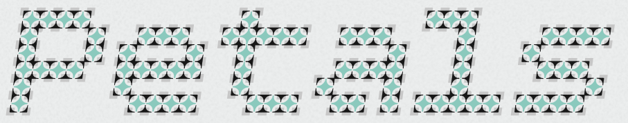
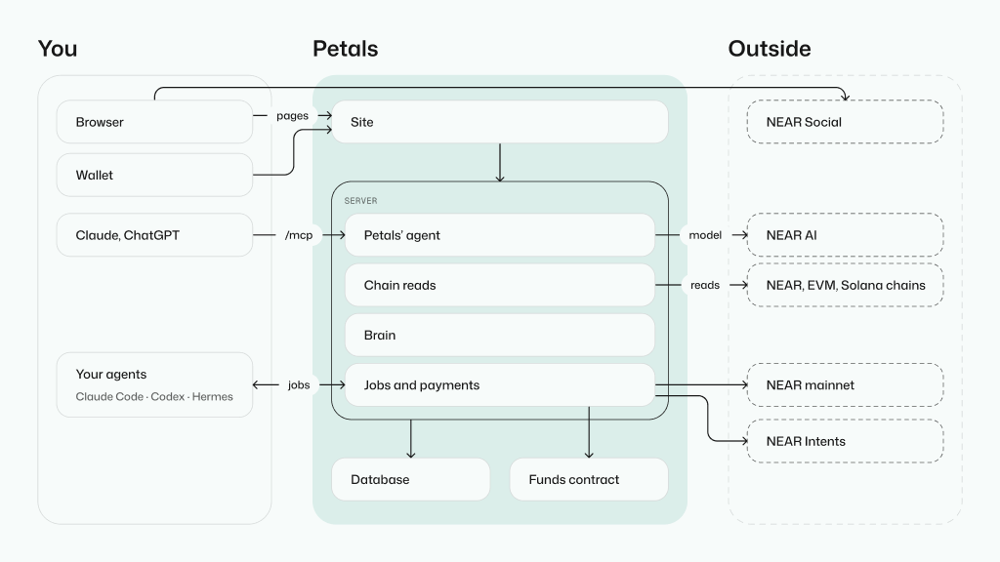
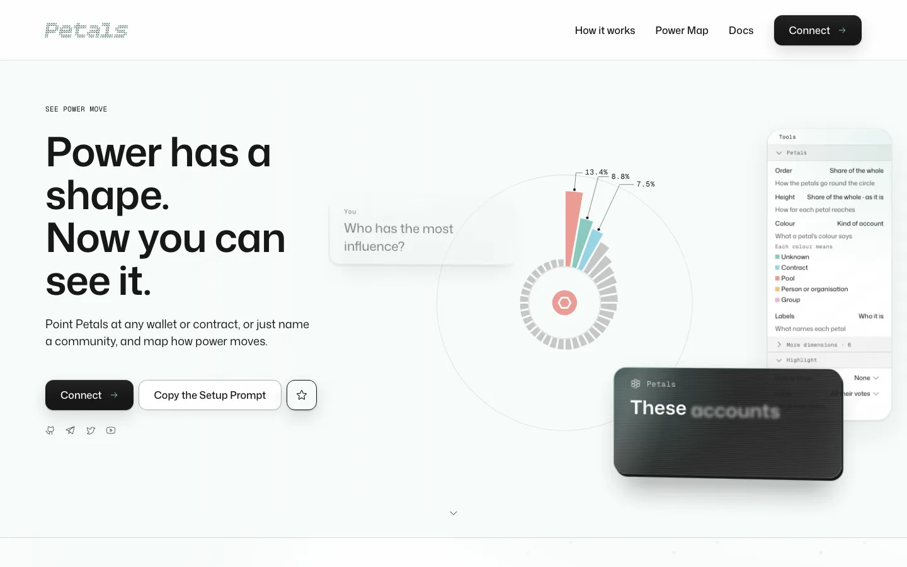
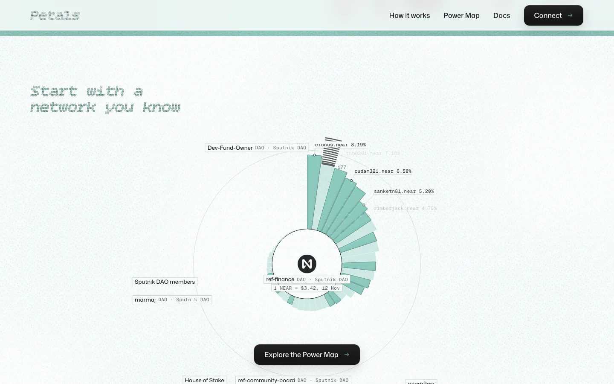
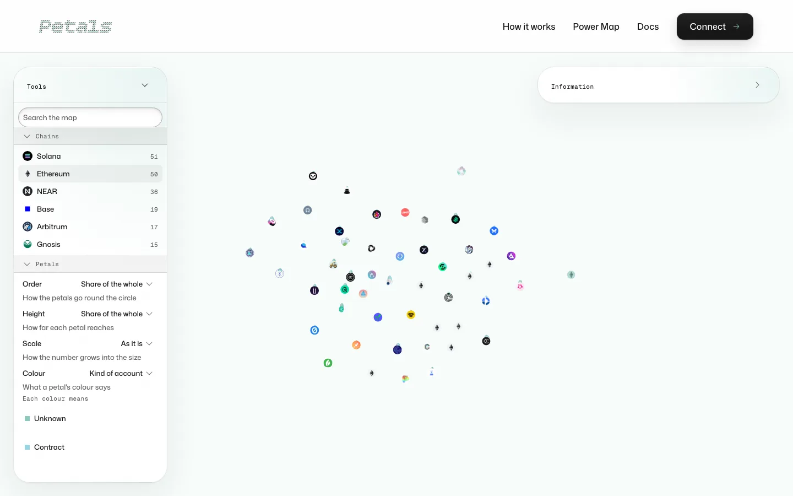

---

title: The media kit
order: 20
---

## Description

**Power has a shape. Now you can see it.** Point Petals at any wallet or contract, or just name a community, and map how power moves.

### Press paragraph

Petals draws any network as a flower. Every account is a petal, and the space in the middle shows the ties between them: delegated votes, shared funding, joint signatures and wallets that answer to the same hands. An agent reads the network’s chain, forum and documents, decides what counts as power there, and explains any petal on request, with the evidence. Petals was built for the NEAR Hackathon in November 2026 by Elementary Complexity. Its agent runs on NEAR AI, it reads networks on NEAR, Ethereum, Base, Arbitrum, Gnosis and Solana, and its code is open under the MIT licence.

## The wordmark, colours and type

On [the assets page](/docs/brand-kit/assets): the wordmark, the brand’s colours, the petals’ keys and the three type families, read from the design tokens.

### Logo, mark and lockup

Petals has one logo: the wordmark, the word Petals in Bitcount Grid Single, drawn in three layers. There is no separate symbol or lockup yet; use the wordmark on its own.

## Icons

The site’s icons come from one family, Phosphor, in its regular weight.

### Petals

The flower: Petals itself, and its agent.

### Power Map

The folded map: the Power Map.

### Brain

The Brain has no icon of its own yet; its picture is the Skill library illustration.

### Agents

The terminal window: an agent connected to Petals.

### NEAR

NEAR’s own mark, as the Power Map shows it beside the networks it reads on NEAR. It belongs to NEAR.

## Illustrations

Nine, on [the assets page](/docs/brand-kit/assets#illustrations).

## The system map

## Screenshots

The home page.

A network you know: Ref Finance, a DAO on NEAR, drawn as a flower.

The Power Map: every network Petals has read, by chain.

## Demo

- [Open the live site](https://petals.elementarycomplexity.com).
- [Explore the Power Map](/map).
- [Read a real flower](/docs/ideas/read-a-flower).
- [How Petals fits together](/docs/getting-started/how-petals-works).
- [Read the project README](/docs/getting-started/readme).
- [Repository](https://github.com/elcocoel/petals).

## Contact and usage

Petals is made by [Elementary Complexity](https://elementarycomplexity.com); write there. The code is open under the MIT licence on [GitHub](https://github.com/elcocoel/petals). The wordmark, illustrations and screenshots here are for writing about Petals; for anything else, ask first.
