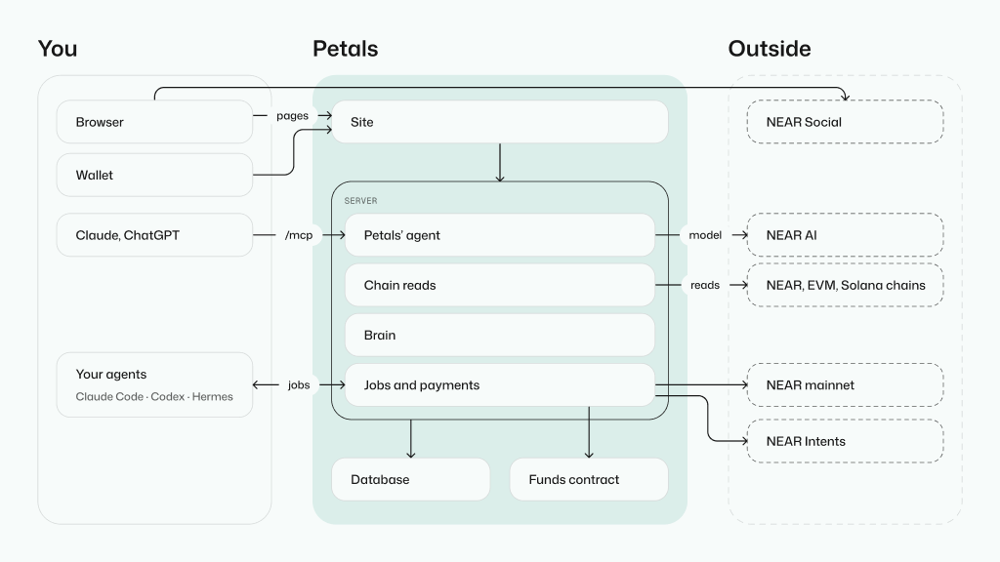

---

title: How Petals fits together
order: 10
---

Petals helps a person explore how power is arranged in a network. A flower gives the person a view of the data; an agent helps them decide what to read and what to investigate next.

## Follow one question

Suppose the question is: **who holds voting power here?** A useful answer needs more than a list of token holders. The system may separate holdings, delegated votes, membership and the authority to execute a decision.

1. **Identify the system.** Start from an address or a known network. The brain helps the agent choose a reading method.
2. **Read bounded data.** Keep the source and the block or date. State what the reading covers and what it leaves out.
3. **Calculate from that data.** Tools produce the numbers the agent can cite.
4. **Draw a flower.** A view connects pieces of data to dimensions. Each account becomes a petal.
5. **Investigate further.** Inspect an account, compare a different piece of data, or ask the agent to follow a source. An inference stays distinguishable from a recorded fact.

## The parts and their boundaries

[Open the system map](/docs/assets/how-it-fits-together.png).

| Part              | What it contributes                                                             | Read next                                          |
| ----------------- | ------------------------------------------------------------------------------- | -------------------------------------------------- |
| Brain             | Doctrine, chapters and reading recipes used by agents                           | [The brain](/docs/brain)                           |
| Data protocol     | Versioned records of what was read, added or claimed                            | [The data protocol](/docs/data-protocol)           |
| View and renderer | Choices about what each dimension shows, followed by the drawing                | [The rendering protocol](/docs/rendering-protocol) |
| Site and server   | The interface, API, saved work and access to the tools                          | [The API](/docs/api)                               |
| Your agents       | Tools running through an agent connection, including work returned to a project | [Connect your agent](/docs/connect-your-agent)     |

## Two ways to read these docs

**Guides** explain a task or a concept in words written for readers.

**System reference** comes directly from the files the system uses: brain chapters, protocols, schemas and contracts. These pages name their source and link to it.
